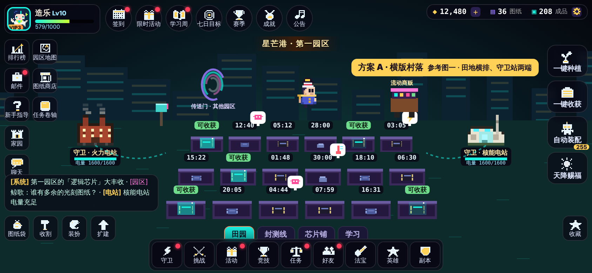
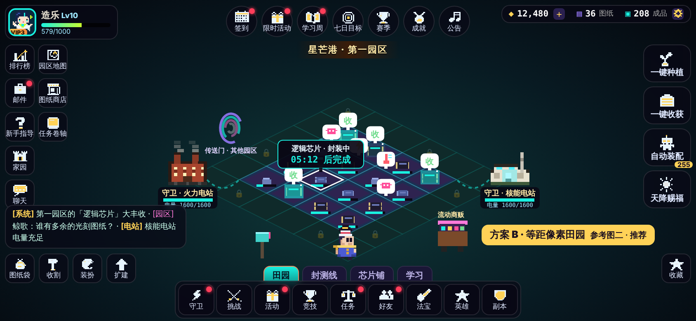
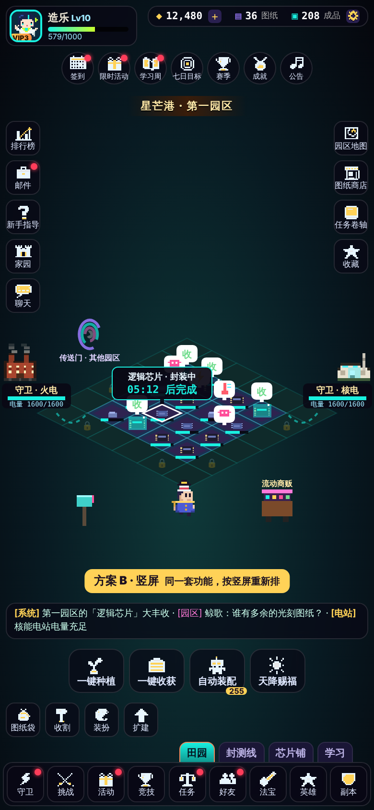

# 「造芯田园」布局分析（v6 · 只做方案，不实装）

> 主创要求：发电厂以后发展成类似 QQ 农场的种植休闲模块；**发电厂 = 农场的守卫**，两个发电厂对应两个守卫；**种植 = 组装、制作芯片**。参考图一（横版村落农场）和图二（像素等距田园）只是参考，要按我们的情况重新布局，但**两张图里有的功能都要有**。
> 这一版**不写任何玩法代码**，只做两套布局的线框图和分析，你评估后再定。线框图由 `tools/farm-mockups.cjs` 用游戏里现成的像素素材画出，在 `design/farm-mockups/`。

| 方案 A · 横版村落（参考图一） | 方案 B · 等距像素田园（参考图二） | 方案 B · 竖屏 |
|---|---|---|
|  |  |  |

---

## 一、先把「农场」翻译成我们的世界观

| 农场里的东西 | 在《造月之路》里叫 | 说明 |
|---|---|---|
| 农场 | **造芯田园**（暂名，和「造乐」「造月」同一个「造」） | 一块块「晶圆田」 |
| 种子 | **芯片图纸** | 逻辑芯片、存储芯片、传感芯片、光芯片……不同图纸成熟时间不同 |
| 作物生长 | **晶圆 → 光刻 → 封装 → 成品** 四个阶段 | 线框图里每块田上的小芯片就是这四个阶段 |
| 收获的菜 | **成品芯片** | |
| 灵兽 / 宠物守卫 | **两座发电厂守卫**：火力电站（珍珠街电站）、核能电站（奥布宁斯克） | 有「电量」（参考图一的 1600/1600）；给田园供电，替你赶走来捣乱的乱码 |
| 虫害气泡 | **乱码虫**（粉色） | 点一下就是「除错」 |
| 缺水气泡 | **断电**（黄色闪电）/ **过热**（温度计） | 用守卫的电量去供电、冷却 |
| 厨房 | **封测线** | 把成品芯片加工成更高级的芯片（像做菜） |
| 小馆 | **芯片铺** | NPC 来下订单，交货换晶片 |
| 学习页 | **学习** | 直接连到电路工坊、学院（我们本来就有） |
| 天降赐福 | **天降赐福**（电网满载：一段时间内全部田加速） | 建议和「学习计时」挂钩：学够时间就送一次 |
| 自动种植（255 次） | **自动装配**（剩余次数） | |
| NPC 商人马车 | **流动商贩** | 不定时出现，卖稀有图纸 |
| 传送门 | **传送门 · 其他园区** | 去别的园区（扩张用的新地图）；单机游戏里的「好友」可以先做成 AI 邻居 |
| 熊猫村（地名） | **星芒港 · 第一园区** | |

## 二、两张参考图的功能，全部保留

两套方案的功能**完全一样**，区别只在摆放位置。下表是逐项核对（✓ = 线框图里已经画出）。

| 来源 | 功能 | 我们的名字 | A | B |
|---|---|---|---|---|
| 图一 | 头像 + VIP + 等级 + 名字 | 头像、VIP3、Lv10、经验条 | ✓ | ✓ |
| 图一 | 顶部 7 个活动图标 | 签到、限时活动、学习周、七日目标、赛季、成就、公告 | ✓ | ✓ |
| 图一 + 图二 | 货币栏（+ 号、设置） | 晶片（+）、图纸、成品、设置 | ✓ | ✓ |
| 图一 | 左侧：排行榜、邮件、新手指导、家园、聊天 | 同名 | ✓ | ✓ |
| 图一 | 作物上方倒计时 | A：每块田都挂；B：生长中显示进度条，点田看详情卡 | ✓ | ✓ |
| 图一 | 两只守卫宠物 + 能量 1600/1600 | 火力电站、核能电站 + 电量 | ✓ | ✓ |
| 图一 | NPC 商人马车 | 流动商贩 | ✓ | ✓ |
| 图一 | 传送门 | 传送门 · 其他园区 | ✓ | ✓ |
| 图一 | 区域名 | 星芒港 · 第一园区 | ✓ | ✓ |
| 图一 | 右侧：一键种植、一键收割、自动种植（255）、天降赐福 | 一键种植、一键收获、自动装配（255）、天降赐福 | ✓ | ✓ |
| 图一 | 底部 9 个系统入口 + 红点 | 守卫、挑战、活动、竞技、任务、好友、法宝、英雄、副本 | ✓ | ✓ |
| 图一 | 聊天滚动条（系统消息） | 系统 / 园区 / 电站消息 | ✓ | ✓ |
| 图二 | 等级经验 579/1000 | 同上（头像旁） | ✓ | ✓ |
| 图二 | 左侧小图标：地图、种子袋、卷轴 | 园区地图、图纸商店、任务卷轴 | ✓ | ✓ |
| 图二 | 作物上的虫害 / 缺水气泡 | 乱码虫、断电、过热、可收获 | ✓ | ✓ |
| 图二 | 邮箱、主角在田里走动 | 邮箱、主英雄在田里走 | ✓ | ✓ |
| 图二 | 左下快捷道具：种子袋、收割、刷子、树苗 | 图纸袋、收割、装扮、扩建 | ✓ | ✓ |
| 图二 | 底部页签：农场、厨房、小馆、学习 | 田园、封测线、芯片铺、学习 | ✓ | ✓ |
| 图二 | 星星按钮 | 收藏 | ✓ | ✓ |
| 图二 | 可扩建的田地 | 外圈带锁的晶圆田 | 部分（加排） | ✓ |

> 和参考图的一个不同：两张参考图都把「种子袋」放了两次。我们拆成「图纸商店」（买）和「图纸袋」（背包里已有的），避免同一个按钮出现两遍。

## 三、对比

| 评估项 | A · 横版村落 | B · 等距像素田园 |
|---|---|---|
| **和现有画风是否一致** | 一般。侧视角，和战场、电路工坊的俯视网格不是一套视角 | **好**。像素 + 网格，和《地图与网格宪法》的「建造格」、电路工坊的接线点是同一种语言 |
| **竖屏** | 难。横排的田在竖屏里只能缩得很小或者要左右滑 | **好**。菱形田地在竖屏里正好竖着放，见第三张图 |
| **横屏** | 好。田地大、横向舒展 | 好 |
| **倒计时可读性** | **好**。每块田上面直接挂时间，一眼看完 | 一般。等距视角下田挨得近，时间会挤在一起，所以改为进度条 + 点开看详情（加上「一键收获」，日常基本不用看时间） |
| **点击准确度** | **好**。长方形田，手指好点 | 一般。菱形格要放大判定范围、点中后高亮（线框图里白框那块）；田最小也要 ≥ 44 屏幕像素 |
| **扩建的感觉** | 一般。只能「加一排」 | **好**。外圈带锁的田一块块解锁，像金铲铲的棋盘、部落冲突的地块 |
| **守卫（发电厂）的存在感** | 好。站在两端，像图一的两只灵兽 | 好。守在菱形左右两个角，电线连到田里，「供电」的关系更直观 |
| **休闲感 / 装扮空间** | 一般。背景是固定天际线 | **好**。菱形外的空地可以摆装饰（邮箱、商贩、传送门已经在上面） |
| **美术工作量** | 少：长方形田 + 一张背景 | 稍多：需要等距地砖；但都是程序画的像素块，不用外包 |
| **和以后联动** | 一般 | **好**：同一套网格以后可以复用到主城、沉浸模式的基地 |

## 四、我的建议：选 **B（等距像素田园）**，同时吸收 A 的长处

**理由（按重要性）**
1. **竖屏能用**：你这一版专门提了竖屏战斗的问题，我推断你平时会竖着拿手机。休闲模块最常在碎片时间打开，竖屏体验比横屏更重要；A 在竖屏里基本放不下。
2. **画风统一**：我们整个游戏是「像素 + 网格」（战场建造格、电路板接线点）。B 是同一种视觉语言，A 会让这个模块看起来像另一款游戏。
3. **扩建有成长感**：带锁的外圈田地一块块解锁，正好给「芯片种植」一个长期目标，也方便以后加第三、第四个园区（传送门）。

**从 A 拿过来的东西**
- A 的 HUD 骨架：左边社交列、右边四个大号「一键」按钮、底部 9 个系统入口——这些在 B 里原样保留（见线框图）。
- A 的「倒计时」信息量：B 用「进度条 + 点田看详情卡 + 一键收获」来补；成熟的田直接冒「收」字气泡，不用看时间。

**B 的风险和对策**
| 风险 | 对策 |
|---|---|
| 菱形田点不准 | 点击判定按菱形外接矩形放大 20%；按下时高亮；田的屏幕宽度 ≥ 44 px（竖屏 4×4 时约 52 px） |
| 倒计时不直观 | 进度条 + 详情卡；长按田地显示全部倒计时（像 A 一样） |
| 竖屏信息太多 | 竖屏把四个「一键」按钮移到田地下方（拇指够得着），活动图标缩小成一排 |

## 五、需要你评估 / 决定的
1. **选 A 还是 B**（或者 B 的竖屏为主、横屏为辅）。
2. 「好友 / 偷菜」：我们是单机离线游戏，建议先做成「AI 邻居园区」（通过传送门去拜访），以后有服务器再做真人好友。要不要这样？
3. 名字：「造芯田园」「晶圆田」「芯片图纸」「封测线」「芯片铺」这几个暂名是否满意。

评估定下来之后，下一版再写《造芯田园宪法》（数值：成熟时间、电量消耗、守卫等级、扩建价格）并实装。
