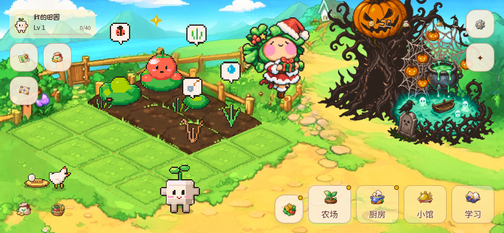
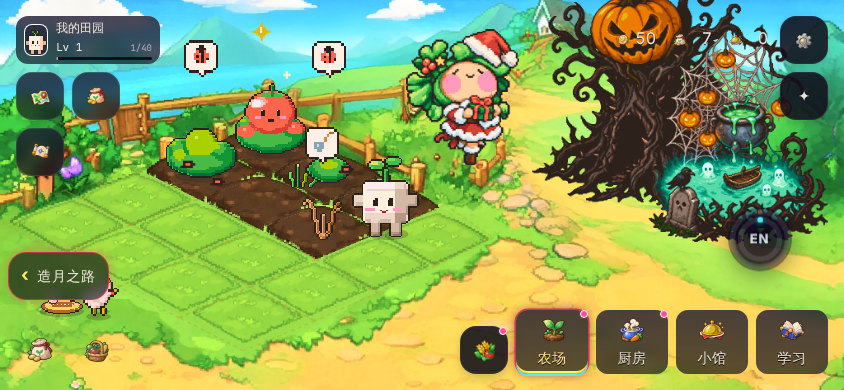
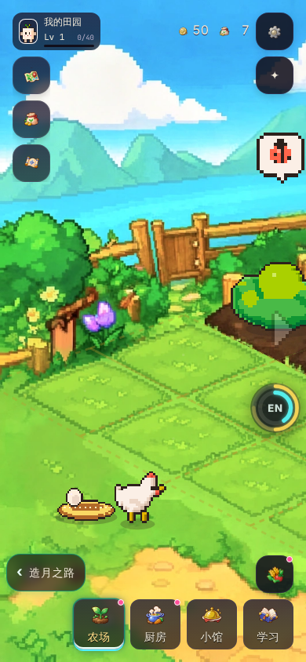

# 英语田园：移植与改造记录（v8 · 第一阶段已实装）

> 主创要求（v8）：把之前做过的英语学习农场「生而向星」（`41b0c900-base.apk`，v1.10.0 build 39）里的 **UI、布局、角色等**，用《造月之路》自己的美术宪法、UI 宪法改造；**保留它的所有功能**。
> 「已经做的角色，不用管了」——这一版不重画任何角色（豆豆、五位小动物客人、植物精灵、节日装扮都保持原样）。

---

## 一、结论

1. **已经能玩**：大厅底部导航新增「田园」（🌱 像素芽图标）。点进去是完整的原版英语农场（种地、厨房、小馆、学习页、课程系统、口语评分、地图、商店、装扮、任务、指南、界面编辑、课程表格导入导出、备份、更新），**一个功能都没删**。
2. **界面已经换成造月之路的样子**：深空黑底、紫夜玻璃面板、米白文字、破晓橙主按钮、探索青选中、当前主英雄的主光做选中光效并随节拍呼吸；字体换成造月之路的系统字体栈。
3. **和主游戏打通了一件事：学习计时**。在田园里学习和在学院、电路工坊一样计时（连续 25 分钟 / 零散 40 分钟换无限体力），田园里也有同一个悬浮双环。
4. **第二阶段（要你评估）**：场景画（农场底图、地图、厨房、小馆）仍是原版的明亮田园画风；田园的金币、星屑和主游戏的晶片还没有互通。见第五节。

## 二、实际效果（截图在 `design/farm-shots/`）

| 原版 | 改造后（横屏） | 改造后（竖屏 · 从造月之路进入） |
|---|---|---|
|  |  |  |

面板页（厨房、学习、设置、商店）见 `farm-shots/after-panels.png`。

## 三、怎么做的（换皮，不改功能）

田园原版代码在 `farm/`，由 12 层 CSS / JS 叠起来（farm-ui → v3 布局 → v4 界面编辑 → v6 沉浸 → v8 场景 → content9 课程 → god-editor10 → ui-system11 → ui-experience12）。改造只做了下面几件事。**主创要求「只改 UI，其它的不要动」：田园的功能逻辑全部用原版**，和原版相比只有颜色、字体、界面样式不同（`tools/farm-skin.mjs` 只改 CSS 和两个文件里的默认配色常量，其余 JS 原样复制）：

| 改动 | 文件 | 说明 |
|---|---|---|
| **按用途换色** | `tools/farm-skin.mjs` | 扫描全部 10 个 CSS 文件和 `index.html` 里的样式（1637 条声明、852 处颜色），**按 CSS 属性的用途**分三类映射到《游戏界面视觉宪法》第 2 章色板：文字（color…）→ 米白 / 灰紫 / 亮色强调；底色（background…）→ 深空黑 / 紫夜面板（原版越亮的纸面 → 越「抬起」的面板）；线条（border / box-shadow…）→ 紫夜分隔线、深色阴影。同一条规则里底色被换成亮色（按钮、徽章）时，文字自动换深色。原版素材不动，脚本可以从原版 APK 重新生成。 |
| **主题令牌** | 同上（改 `farm-editor-v4.js`、`immersive-v6.js`） | 原版「界面编辑」的默认配色 `UI4BASE` / `IMM6_COLORS` 换成造月色板。五套配色方案**保留**（功能不变），改成深色版：造月（默认）· 田园（深绿）· 海盐（深海）· 莓果（深莓）· 奶油（暖夜）。原版把「描边棕」也当标题字色，脚本把这些地方改指向米白标题色，保证对比度。 |
| **皮肤层** | `farm/zaoyue-skin.css`（最后加载） | 换色做不到的部分：字体栈（字体宪法第 4 章）、HUD / 侧栏 / 页签的半透明玻璃（UI 宪法第 8 章 `rgba(9,7,20,.62)` + 6px 模糊）、选中态 = 英雄主光 + 节拍呼吸（第 0、2.2 章）、主按钮 = 破晓渐变 + 深色字、减少动效。 |
| **桥接** | `farm/zaoyue-bridge.js` | 只有从造月之路进来（网址带 `?zy=1`）才生效：左下「‹ 造月之路」返回键、悬浮学习双环、学习计时、英雄主光、安卓返回键。单独打开田园时完全是原版行为。 |
| **入口** | `js/farm.js`、`js/lobby.js`、`js/stamina.js` | 大厅「田园」入口；回到大厅时结算学习时间（`CF.Stamina.credit`）。 |
| **安卓壳** | `android/…/MainActivity.java`、`AndroidManifest.xml`、`build-apk.sh` | 见第四节。 |

**验证**：Playwright 逐页截图 + 自动对比度检查（每个带文字的元素算文字色和底色的对比度）。改造前首页 1 处、厨房 10 处、学习页 8 处、设置 7 处、商店 9 处对比度 < 3:1；改造后只剩 3 个「渐变底主按钮」被检查器误报（检查器看不到渐变底，截图确认是破晓橙底深色字）。

## 四、为什么是「整页切换」而不是嵌在 iframe 里

- 安卓 WebView 里，`file://` 页面里嵌的 https iframe 的本地存储可能被浏览器分区，**田园存档不保证留得住**；田园又必须用 https 来源才能用 fetch、Web Worker、WebAssembly 和浏览器缓存（发音模型、口语评分模型）。
- 所以 APK 里：造月之路仍是 `file:///android_asset/index.html`（老存档不受影响）；田园是 `https://appassets.androidplatform.net/farm/…`，由 `MainActivity.shouldInterceptRequest` 从 `assets/farm/` 读文件。两边各自是「第一方」页面，存档都可靠。
- 切换用原生接口：`XSNative.openFarm(url)` / `XSNative.backToGame(秒数)`（https 页面不能自己跳到 `file://`）。
- 田园原版安卓壳的 `AndroidFiles` 接口全部补上（名字和用法一致，田园代码不用改）：导出备份（系统「另存为」）、麦克风权限（口语评分，第一次用到才申请）、版本号、网络类型（语音包只在 Wi-Fi 下自动下载）、编辑器震动。
- 新增权限：**联网**（第一次下载英文发音模型、口语评分模型（田园里提示约 40 MB）、检查课程更新）、**录音**（口语评分，识别在手机本地完成）。不联网时其余功能照常。
- 英文发音模型：和原版安卓壳一样，田园向本地 `vendor/kokoro/onnx-community/…` 要模型文件，`MainActivity` 第一次从原版的下载地址取回（约 92 MB，存在手机里，以后离线可用）。
- 版本号按田园原版返回（1.10.0 / build 39），所以田园自己的「检查更新」和原版完全一样（包括原版会提示下载新版「生而向星」安装包的逻辑）。

**没能在真机上测**：这里没有安卓模拟器。我用浏览器模拟了 APK 的 https 资源域名和原生接口（`t91`：加载、换主题色、返回键先回田园首页再回造月之路、学习时长带回），都通过；安装包能编译、签名、校验通过。**麦克风、另存为、首次下载模型这三件需要你在手机上点一遍。**

## 五、第二阶段：需要你评估的

| # | 项目 | 现状 | 建议 |
|---|---|---|---|
| 1 | **场景画风** | 农场底图、开垦图、世界地图、潮流街区、万圣节主题都是原版的明亮手绘像素画（`farm/art/*.webp`）。面板已经是紫夜玻璃，场景还是白天田园——「白天的田 + 夜色的 UI」现在看是协调的，但和战场、电路工坊的「紫夜 + 霓虹」不是一套。 | 两个方向选一个：A 保留白天田园（学习区就该明亮，和战斗区形成反差）；B 按 UI 宪法重画成「紫夜破晓」的田园（工作量大：5 张 2048 宽的底图 + 地块裁切坐标）。**我推荐 A**，只给夜晚模式加一层紫夜色调。 |
| 2 | **角色** | 豆豆（豆腐吉祥物）、五位小动物客人、植物精灵——按你的要求这一版没动。豆豆本身已经符合《角色设计宪法》第 17 章的吉祥物标准（非人形、剪影清楚、一眼能认）。 | 如果以后要统一世界观：可以让当前主英雄在田园里出现（比如站在小馆门口），不替换豆豆。 |
| 3 | **两套经济** | 田园有自己的金币、星屑、星币（本机演示货币，不是真钱）、种子、作物、菜品；和主游戏的晶片 / 语料 / 算力互不相通，唯一的连接是学习时间 → 无限体力。 | 要不要互通？建议只做单向、有上限的兑换（例如田园每日任务全部完成 → 主游戏 +1 学习加速），避免田园变成刷晶片的地方（物品宪法第 1 章第 2 条）。 |
| 4 | **图标** | 田园用的是它自己的彩色像素图标（`farm/art/ui-v2/*.png`），不是 UI 宪法第 12 章的单色 12×12 图标。 | 田园的图标是有颜色的像素画，换成单色会丢信息（作物、菜品要靠颜色认）。建议田园保留彩色图标，在 UI 宪法里写明「田园例外」。 |
| 5 | **和 v6「造芯田园」方案的关系** | v6 的 `04-farm-layout-analysis.md` 是「种芯片」的新玩法方案，还没做。 | 英语田园 = 学英语；造芯田园 = 芯片 / 发电厂守卫。可以做成田园里的第二块地（传送门过去），或者放弃造芯田园。 |
| 6 | **许可** | 发音引擎 kokoro-js 打包了 espeak-ng 音素器（**GPL-3.0**）；随 APK 分发时要满足 GPL（提供对应源码或获取方式）。 | 见 `design/03-compliance.md` 第一部分第 11 项。 |

## 六、以后要改田园时

1. 改原版功能：直接改 `farm/` 里对应的文件。
2. 换一版原版 APK：解包后运行 `node tools/farm-skin.mjs <新版 assets 目录> farm/`，再把 `zaoyue-skin.css`、`zaoyue-bridge.js` 留在 `farm/` 里（脚本会自动在 `index.html` 末尾引用它们）。
3. 测试：`python3 -m http.server`（在 `games/claude-frontline/` 里），浏览器打开大厅 → 田园。

## 七、第二轮（主创反馈：「这个 UI 布局的效果不行」）：改造「豆豆的田园厨房」artifact

主创要求改造 https://claude.ai/artifact/SpThW6bDh2D45kKf1zM5ge（第 27 版），而且不是换颜色，是**用造月之路自己的做法**（UI 宪法第 25 章）：

- 已发布到原链接（版本 26），原来的云端存档、进度不受影响；原版文件在本地留有备份，随时可以回退。
- 做了：主题英雄（10 位可选，默认造乐）、状态栏 / 页眉 / 弹窗页眉的像素脉冲舞台 + 英雄演奏、英雄主题曲做默认背景音乐并驱动光效、像素转场、底部导航像素图标 + 「英雄」入口、深色玻璃卡片与破晓橙主按钮。
- 没动：玩法、数据、存档、原版三首小曲与上传音乐（仍可选）、原版的界面颜色编辑器（关掉造月之路主题后仍然生效）。
- 构建：`node tools/farm-zy-build.mjs <原版目录> <输出目录>`（原版文件原样复制，只在页面末尾加 `zy/` 下四个文件，并给背景音乐加一个「英雄主题曲」选项）。
- 已知：原版的「导出备份」用的是网页下载链接，在 claude.ai 的 artifact 里本来就点不动（不是这次改造引入的）；要能用，需要改成 artifact 的下载接口，这属于功能改动，等你决定。

